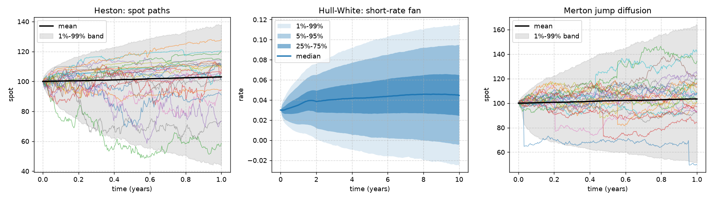

<h1 align="center">stochPathSim</h1>

<p align="center"><b>Stochastic path simulation, derivatives pricing and risk analytics for quantitative finance.</b></p>

<p align="center">
  <a href="https://github.com/AIM-IT4/stochPathSim/actions/workflows/ci.yml"></a>
  <a href="https://pypi.org/project/stochPathSim/"></a>
  <a href="https://pypi.org/project/stochPathSim/"></a>
  <a href="https://aim-it4.github.io/stochPathSim/"></a>
  <a href="LICENSE"></a>
</p>

<p align="center"></p>

stochPathSim simulates the stochastic processes used in equity, FX and interest-rate modelling, prices
derivatives on the simulated paths, and turns them into risk measures such as exposure profiles, CVA and
VaR. It also includes the statistical tests used to backtest risk-factor models.

Every model is **validated against an independent reference** in the test suite. Monte Carlo prices are
checked against closed forms within a few standard errors, and the semi-analytic formulas (Heston, SABR,
Hull-White bond options) agree with [QuantLib](https://www.quantlib.org) to 1e-10 or better.

```bash
pip install stochPathSim            # core: numpy, scipy, pandas
pip install "stochPathSim[plot]"    # plus matplotlib for plotting
```

## Quick start

```python
import stochPathSim as sps
from stochPathSim.analytics import heston_price
from stochPathSim.pricing import EuropeanCall, price_mc

model = sps.Heston(s0=100, mu=0.03, v0=0.04, kappa=1.5, theta=0.04, xi=0.6, rho=-0.7)

paths = model.simulate(T=1.0, n_steps=252, n_paths=50_000, seed=42)   # SimulationResult
paths["spot"].shape          # (50000, 253): column 0 is the initial value
paths.quantile([0.01, 0.99])  # 1% and 99% bands at every time step
paths.plot()                  # sample paths, mean and quantile band

mc = price_mc(model, EuropeanCall(110), T=1.0, discount=0.03,
              n_steps=50, n_paths=200_000, seed=42, antithetic=True)
exact = heston_price(100, 110, 1.0, 0.03, 0.0, v0=0.04, kappa=1.5, theta=0.04, xi=0.6, rho=-0.7)
print(f"MC {mc.price:.4f} +/- {mc.stderr:.4f}   semi-analytic {exact:.4f}")
# MC 3.4073 +/- 0.0124   semi-analytic 3.4163
```

## What's inside

### Processes (`stochPathSim.processes`)

| Model | Class | Simulation scheme |
| :-- | :-- | :-- |
| Geometric Brownian motion | `GBM` | exact |
| Correlated multi-asset GBM | `MultiAssetGBM` | exact (Cholesky) |
| Merton jump diffusion | `MertonJumpDiffusion` | exact, compensated jumps |
| Heston stochastic volatility | `Heston` | Andersen QE (default) or full-truncation Euler |
| Bates (Heston + jumps) | `Bates` | QE + compensated jumps |
| SABR | `SABR` | exact volatility, absorbing forward |
| Constant elasticity of variance | `CEV` | Euler, absorbing at 0 |
| Variance gamma | `VarianceGamma` | exact gamma time change |
| Ornstein-Uhlenbeck | `OrnsteinUhlenbeck` | exact |
| Vasicek | `Vasicek` | exact, joint with the rate integral |
| Cox-Ingersoll-Ross | `CIR` | exact (non-central χ²) or full-truncation Euler |
| Hull-White, fitted to any zero curve | `HullWhite` | exact, reproduces the curve |
| Ho-Lee, fitted to any zero curve | `HoLee` | exact, reproduces the curve |
| G2++ two-factor Gaussian | `G2pp` | exact, reproduces the curve |
| Black-Karasinski | `BlackKarasinski` | exact in ln r |
| Black-Derman-Toy | `BlackDermanToy` | exact in ln r |

Short-rate models also return the **pathwise discount factor** `exp(-∫r dt)`. All processes support
seeds, antithetic variates, custom non-uniform time grids and common random numbers (`normals=`).

### Analytics (`stochPathSim.analytics`)
- **Black-Scholes:** prices, Greeks and implied volatility, plus Black-76 and Bachelier (normal) prices and implied vols.
- **Heston:** semi-analytic price from the characteristic function ("little Heston trap").
- **Merton:** jump-diffusion series price.
- **SABR:** Hagan implied volatility, including the shifted variant.
- **Zero-coupon bonds:** Vasicek, CIR, Hull-White and G2++ prices, plus Vasicek and Hull-White bond options (Jamshidian) and Hull-White caplets.

### Pricing (`stochPathSim.pricing`)
- **Payoffs:** European, digital, arithmetic and geometric Asian, barriers (all 8 types, with Broadie-Glasserman continuity correction), fixed and floating lookbacks, basket and spread.
- **`price_mc`:** Monte Carlo pricing with standard errors and confidence intervals, antithetic variates and control variates. Discounting can use a flat rate, a `ZeroCurve` or the pathwise discount factor.
- **`longstaff_schwartz`:** American options by least-squares Monte Carlo.
- **`crr_price`:** a Cox-Ross-Rubinstein binomial tree.

### Risk (`stochPathSim.risk`)
- **Exposure:** EE, ENE, PFE, EPE, Effective EE/EPE (Basel), collateralised exposure with a margin period of risk, and unilateral CVA (`ExposureProfile`).
- **VaR and Expected Shortfall:** historical, parametric and Cornish-Fisher.
- **Path statistics:** P-level, quantile bands and exceedance counts.
- **Risk-factor backtesting:** PIT values, Anderson-Darling and Cramér-von Mises uniformity tests, Kupiec POF and Christoffersen independence.

### Calibration (`stochPathSim.calibration`)
- `fit_gbm`, `fit_ou`/Vasicek (exact MLE) and `fit_cir` (exact non-central χ² MLE) from time series.

## Examples

| Example | What it shows |
| :-- | :-- |
| [`01_heston_pricing.py`](examples/01_heston_pricing.py) | Heston call: semi-analytic vs Monte Carlo, implied vol |
| [`02_hull_white_curve.py`](examples/02_hull_white_curve.py) | Hull-White fitted to a curve; Monte Carlo bond prices reproduce it |
| [`03_exposure_profile.py`](examples/03_exposure_profile.py) | FX forward exposure: EE, PFE, effective EE, collateral and CVA |
| [`04_risk_factor_backtest.py`](examples/04_risk_factor_backtest.py) | Backtesting a risk-factor model with PIT, Anderson-Darling and Kupiec tests |

## Validation

The test suite (`pytest`, about 150 tests, under 30 seconds) checks, among others:

- simulated moments and bond prices against closed forms for GBM, OU, Vasicek, CIR, Merton and variance gamma;
- Heston and Bates Monte Carlo against the semi-analytic price, and that price against QuantLib's `AnalyticHestonEngine`;
- Hull-White, Ho-Lee and G2++ reproducing an upward-sloping zero curve, and Hull-White bond options and caplets against QuantLib;
- barrier in-out parity, the Kemna-Vorst geometric Asian, and Reiner-Rubinstein barriers;
- Longstaff-Schwartz against the published American put value (4.478) and a binomial tree;
- the backtesting tests accepting a correctly specified model and rejecting a misspecified one.

## Upgrading from 1.x

The 1.x classes (`stochPathSim.gbm.GeometricBrownianMotion`, `heston_model.HestonModel`, `vasicek.VasicekModel`, …)
and `statistics_utils` still work, with the same signatures and array shapes. They now run on the new engines, so
some results change because 1.x had modelling errors. See the [changelog](CHANGELOG.md).

## Contributing and citing

Contributions are welcome. See [CONTRIBUTING.md](CONTRIBUTING.md): every new model needs a test against an
independent reference. If you use stochPathSim in research, please cite it using [CITATION.cff](CITATION.cff).

Released under the [MIT license](LICENSE) · Author: [Amit Kumar Jha](https://github.com/AIM-IT4)
