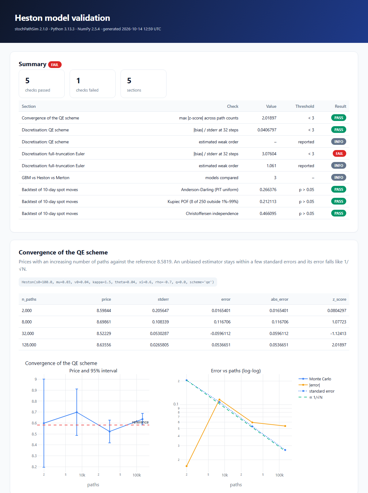

<h1 align="center">stochPathSim</h1>

<p align="center"><b>Stochastic path simulation, derivatives pricing and risk analytics for quantitative finance.</b></p>

<p align="center">
  <a href="https://github.com/AIM-IT4/stochPathSim/actions/workflows/ci.yml"></a>
  <a href="https://pypi.org/project/stochPathSim/"></a>
  <a href="https://pypi.org/project/stochPathSim/"></a>
  <a href="https://aim-it4.github.io/stochPathSim/"></a>
  <a href="LICENSE"></a>
</p>

<p align="center"></p>

stochPathSim simulates the stochastic processes used in equity, FX, commodity, credit and interest-rate
modelling, prices derivatives on the simulated paths, and turns them into risk measures such as exposure
profiles, CVA and VaR. All of its charts are interactive [Plotly](https://plotly.com/python/) figures.

## Why stochPathSim

Most simulation libraries stop at the paths or the price. stochPathSim also answers the question a model
validation team asks next: **can these numbers be trusted?**

- **Validation lab.** `convergence_study` checks Monte Carlo prices against a reference as paths increase, and `discretisation_study` measures the bias of a scheme and estimates its weak order. `compare_models` puts models side by side, and `ValidationReport` writes all of this, plus risk-factor backtests, into **one self-contained interactive HTML report** with pass/fail checks.
- **Built for risk, not just pricing.** It covers exposure profiles (EE, PFE, Effective EPE), collateral with a margin period of risk, CVA, and the PIT, Anderson-Darling, Kupiec and Christoffersen tests used to backtest risk-factor models.
- **Models beyond the textbook set.** It includes rough Bergomi (rough volatility), Kou double-exponential jumps, regime-switching GBM, the Schwartz and Schwartz-Smith commodity models and credit intensity with default times, alongside Heston, SABR and curve-fitted Hull-White and G2++.
- **Every model checked.** Each model is tested against a closed form, a known limit or QuantLib.

<p align="center"></p>

Every model is **validated against an independent reference** in the test suite. Monte Carlo prices are
checked against closed forms within a few standard errors, and the semi-analytic formulas (Heston, SABR,
Hull-White bond options) agree with [QuantLib](https://www.quantlib.org) to 1e-10 or better.

```bash
pip install stochPathSim              # numpy, scipy, pandas, plotly
pip install "stochPathSim[export]"    # adds kaleido for PNG/SVG export of charts
```

## Quick start

```python
import stochPathSim as sps
from stochPathSim.analytics import heston_price
from stochPathSim.pricing import EuropeanCall, price_mc

model = sps.Heston(s0=100, mu=0.03, v0=0.04, kappa=1.5, theta=0.04, xi=0.6, rho=-0.7)

paths = model.simulate(T=1.0, n_steps=252, n_paths=50_000, seed=42)   # SimulationResult
paths["spot"].shape          # (50000, 253): column 0 is the initial value
paths.quantile([0.01, 0.99])  # 1% and 99% bands at every time step
paths.plot()                  # interactive Plotly chart: paths, mean, 1%-99% band
paths.fan()                   # fan chart of nested quantile bands

mc = price_mc(model, EuropeanCall(110), T=1.0, discount=0.03,
              n_steps=50, n_paths=200_000, seed=42, antithetic=True)
exact = heston_price(100, 110, 1.0, 0.03, 0.0, v0=0.04, kappa=1.5, theta=0.04, xi=0.6, rho=-0.7)
print(f"MC {mc.price:.4f} +/- {mc.stderr:.4f}   semi-analytic {exact:.4f}")
# MC 3.4073 +/- 0.0124   semi-analytic 3.4163
```

## What's inside

### Processes (`stochPathSim.processes`)

| Model | Class | Simulation scheme |
| :-- | :-- | :-- |
| Geometric Brownian motion | `GBM` | exact |
| Correlated multi-asset GBM | `MultiAssetGBM` | exact (Cholesky) |
| Merton jump diffusion | `MertonJumpDiffusion` | exact, compensated jumps |
| Heston stochastic volatility | `Heston` | Andersen QE (default) or full-truncation Euler |
| Bates (Heston + jumps) | `Bates` | QE + compensated jumps |
| SABR | `SABR` | exact volatility, absorbing forward |
| Constant elasticity of variance | `CEV` | Euler, absorbing at 0 |
| Variance gamma | `VarianceGamma` | exact gamma time change |
| Ornstein-Uhlenbeck | `OrnsteinUhlenbeck` | exact |
| Vasicek | `Vasicek` | exact, joint with the rate integral |
| Cox-Ingersoll-Ross | `CIR` | exact (non-central χ²) or full-truncation Euler |
| Hull-White, fitted to any zero curve | `HullWhite` | exact, reproduces the curve |
| Ho-Lee, fitted to any zero curve | `HoLee` | exact, reproduces the curve |
| G2++ two-factor Gaussian | `G2pp` | exact, reproduces the curve |
| Black-Karasinski | `BlackKarasinski` | exact in ln r |
| Black-Derman-Toy | `BlackDermanToy` | exact in ln r |
| Rough Bergomi (rough volatility) | `RoughBergomi` | exact joint Gaussian Volterra sampling |
| Kou double-exponential jumps | `KouJumpDiffusion` | exact, compensated jumps |
| Regime-switching GBM | `RegimeSwitchingGBM` | exact Markov-chain transitions |
| Schwartz one-factor commodity | `SchwartzOneFactor` | exact |
| Schwartz-Smith two-factor commodity | `SchwartzSmith` | exact |
| Credit intensity (constant, CIR) | `ConstantIntensity`, `CIRIntensity` | exact, with default-time sampling |

Short-rate models also return the **pathwise discount factor** `exp(-∫r dt)`. All processes support
seeds, antithetic variates, custom non-uniform time grids and common random numbers (`normals=`).

### Analytics (`stochPathSim.analytics`)
- **Black-Scholes:** prices, Greeks and implied volatility, plus Black-76 and Bachelier (normal) prices and implied vols.
- **Heston:** semi-analytic price from the characteristic function ("little Heston trap").
- **Merton and Kou:** jump-diffusion prices (a series for Merton, Fourier inversion for Kou).
- **SABR:** Hagan implied volatility, including the shifted variant.
- **Zero-coupon bonds:** Vasicek, CIR, Hull-White and G2++ prices, plus Vasicek and Hull-White bond options (Jamshidian) and Hull-White caplets.

### Pricing (`stochPathSim.pricing`)
- **Payoffs:** European, digital, arithmetic and geometric Asian, barriers (all 8 types, with Broadie-Glasserman continuity correction), fixed and floating lookbacks, basket and spread.
- **`price_mc`:** Monte Carlo pricing with standard errors and confidence intervals, antithetic variates and control variates. Discounting can use a flat rate, a `ZeroCurve` or the pathwise discount factor.
- **`longstaff_schwartz`:** American options by least-squares Monte Carlo.
- **`crr_price`:** a Cox-Ross-Rubinstein binomial tree.

### Risk (`stochPathSim.risk`)
- **Exposure:** EE, ENE, PFE, EPE, Effective EE/EPE (Basel), collateralised exposure with a margin period of risk, and unilateral CVA (`ExposureProfile`).
- **VaR and Expected Shortfall:** historical, parametric and Cornish-Fisher.
- **Path statistics:** P-level, quantile bands and exceedance counts.
- **Risk-factor backtesting:** PIT values, Anderson-Darling and Cramér-von Mises uniformity tests, Kupiec POF and Christoffersen independence.

### Validation lab (`stochPathSim.validation`)
- `convergence_study` and `discretisation_study`, each with a matching interactive plot.
- `compare_models` for terminal moments and quantiles, with overlaid densities.
- `ValidationReport` builds a single self-contained HTML report with pass/fail badges. See [`05_validation_report.py`](examples/05_validation_report.py).

### Interactive charts (`stochPathSim.viz`)
- **Paths:** `paths`, `fan`, `path_explorer` (choose the state and the number of paths), `terminal_distribution` with an optional analytic density overlay, `density_evolution` (heatmap, 3D surface or animation) and `correlation_heatmap`.
- **Risk:** `exposure_dashboard`, `backtest_dashboard` (PIT histogram, QQ plot and exceedance timeline) and `var_plot`.
- **Rates:** `curve_fit_check` and `short_rate_fan`.
- **Themes:** light and dark Plotly themes (`set_theme("dark")`).

### Calibration (`stochPathSim.calibration`)
- `fit_gbm`, `fit_ou`/Vasicek (exact MLE) and `fit_cir` (exact non-central χ² MLE) from time series.

## Examples

| Example | What it shows |
| :-- | :-- |
| [`01_heston_pricing.py`](examples/01_heston_pricing.py) | Heston call: semi-analytic vs Monte Carlo, implied vol |
| [`02_hull_white_curve.py`](examples/02_hull_white_curve.py) | Hull-White fitted to a curve; Monte Carlo bond prices reproduce it |
| [`03_exposure_profile.py`](examples/03_exposure_profile.py) | FX forward exposure: EE, PFE, effective EE, collateral and CVA |
| [`04_risk_factor_backtest.py`](examples/04_risk_factor_backtest.py) | Backtesting a risk-factor model with PIT, Anderson-Darling and Kupiec tests |
| [`05_validation_report.py`](examples/05_validation_report.py) | A full Heston validation report (QE vs Euler, model comparison, backtest) as interactive HTML |

## Validation

The test suite (`pytest`, about 180 tests, under 30 seconds) checks, among others:

- simulated moments and bond prices against closed forms for GBM, OU, Vasicek, CIR, Merton and variance gamma;
- Heston and Bates Monte Carlo against the semi-analytic price, and that price against QuantLib's `AnalyticHestonEngine`;
- Hull-White, Ho-Lee and G2++ reproducing an upward-sloping zero curve, and Hull-White bond options and caplets against QuantLib;
- barrier in-out parity, the Kemna-Vorst geometric Asian, and Reiner-Rubinstein barriers;
- Longstaff-Schwartz against the published American put value (4.478) and a binomial tree;
- the backtesting tests accepting a correctly specified model and rejecting a misspecified one;
- Kou Monte Carlo against its Fourier price; rough Bergomi's forward-variance and martingale conditions and its negative ATM skew, steeper at short maturities;
- regime-switching and credit-intensity models against matrix-exponential and CIR bond-price formulas;
- the discretisation study recovering weak order 1 for Heston's full-truncation Euler scheme.

## Upgrading from 1.x

The 1.x classes (`stochPathSim.gbm.GeometricBrownianMotion`, `heston_model.HestonModel`, `vasicek.VasicekModel`, …)
and `statistics_utils` still work, with the same signatures and array shapes. They now run on the new engines, so
some results change because 1.x had modelling errors. See the [changelog](CHANGELOG.md).

## Contributing and citing

Contributions are welcome. See [CONTRIBUTING.md](CONTRIBUTING.md): every new model needs a test against an
independent reference. If you use stochPathSim in research, please cite it using [CITATION.cff](CITATION.cff).

Released under the [MIT license](LICENSE) · Author: [Amit Kumar Jha](https://github.com/AIM-IT4)
