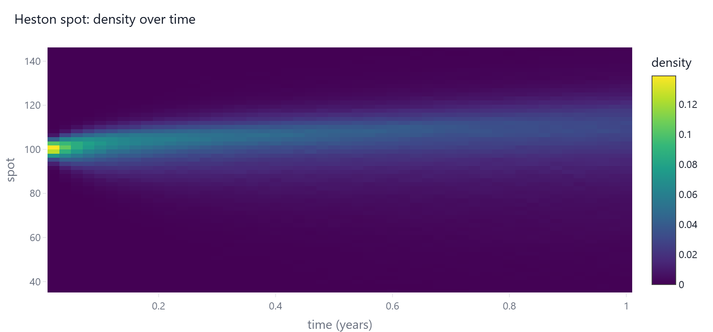

# Interactive charts

Every chart in stochPathSim is a Plotly `Figure`. Call `.show()` in a notebook, `.write_html(path)` for a
standalone page, or `.write_image(path)` (with `pip install "stochPathSim[export]"`) for a PNG or SVG.

```python
import stochPathSim as sps
from stochPathSim import viz

viz.set_theme("dark")                       # or "light"
res = sps.Heston(100, 0.03, 0.04, 1.5, 0.04, 0.6, -0.7).simulate(T=1, n_steps=252, n_paths=20_000, seed=1)

viz.paths(res)                              # sample paths, mean, quantile band
viz.fan(res)                                # nested quantile bands
viz.path_explorer(res)                      # choose the state and the number of paths interactively
viz.terminal_distribution(res)              # histogram, optionally with an analytic density
viz.density_evolution(res, kind="surface")  # 3D surface of the density over time
```



Risk charts take the objects produced by `stochPathSim.risk`: `exposure_dashboard(profile)`,
`backtest_dashboard(pit, ...)` and `var_plot(pnl)`.

Normal portfolio component VaR and ES can be displayed with `viz.portfolio_risk_chart`:

```python
from stochPathSim.risk import normal_portfolio_risk
risk = normal_portfolio_risk([1.0, 0.5], [[0.04, 0.01], [0.01, 0.09]])
viz.portfolio_risk_chart(risk, labels=["Equity", "Rates"]).show()
```
